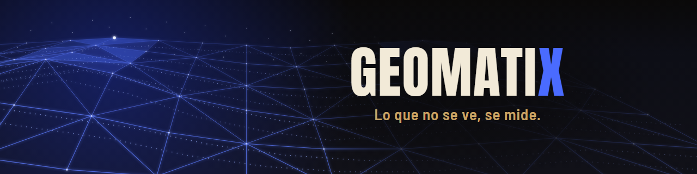

```text
HOJA 1 DE 3 · SIN ESCALA · MAGNA-SIRGAS · GEOGRÁFICAS · EPSG:4686
ELABORÓ: JHON QUEVEDO · INGENIERÍA GEOMÁTICA, UNIVERSIDAD DEL VALLE · COLOMBIA
```

**Mapeo terrenos, negocios y procesos.** Estudio Ingeniería Geomática (medir la Tierra con GPS, satélites y mapas) y uso lo mismo para medir y automatizar todo lo demás. Creo [GeomatiX](https://www.youtube.com/@GeomatiX7): Colombia explicada con mapas y datos.

## Convenciones

| Capa | Qué hago | Con qué |
|---|---|---|
| 🟦 **01 · Terrenos** | Mapas, digitalización y análisis espacial | ArcGIS Pro · QGIS · R · Python |
| 🟨 **02 · Negocios** | Landings, presencia en Google Maps y contenido | HTML/CSS · Node · diseño con DESIGN.md |
| 🟥 **03 · Procesos** | Automatizaciones, agentes de IA y herramientas | Claude Code · Hermes Agent · OpenCode · Ollama |

## Estaciones (proyectos)

| | Proyecto | Capa | Qué es | Dónde verlo |
|---|---|---|---|---|
| ✕ | **[Yuva](https://github.com/GeomatiX7/Yuva)** | 03 | Notas, documentos, tareas y bases de datos en tu equipo: sin cuenta, sin nube y sin internet. TypeScript, Electron y React, con servidor MCP para Claude. | [Repositorio](https://github.com/GeomatiX7/Yuva) |
| ✕ | **MCP para AutoCAD 2027** | 01 · 03 | Servidor MCP local que conecta un asistente de IA con AutoCAD 2027: 52 herramientas para consultar, dibujar, editar, rotular y armar láminas. | Privado por ahora |
| ✕ | **BdH** — La Banda del Halcón | 03 | Plugin de Claude Code: 7 agentes que especifican, escriben los tests antes del código, implementan y revisan con ojos que no escribieron. 13 pruebas documentadas de costo y acierto. | Privado por ahora |
| ✕ | **PgStyl3** | 02 · 03 | Plugin de diseño web: conversación antes de diseñar, `DESIGN.md` compatible con Stitch y revisión medida en Edge a 3 anchos. | Privado por ahora |
| ✕ | **Error de digitalización** (Trujillo, Valle) | 01 | Trabajo en equipo: 278 construcciones digitalizadas sobre ortofoto frente a 265 predios. ArcGIS Pro, MAGNA-SIRGAS, 1:4.000. | Portafolio (pronto) |

## Escala gráfica

```text
0 ─────── 1 ─────── 2 ─────── 3 semestres de Ingeniería Geomática (cursando el 4.º)
├─ SIG y cartografía ......... ArcGIS Pro, QGIS        multicriterio, digitalización, mapas de vulnerabilidad
├─ Datos ..................... R, Python               modelación estadística, servidor MCP para AutoCAD
├─ Web y apps ................ HTML, CSS, TypeScript   portafolio, landings, Yuva (Electron + React)
└─ IA aplicada ............... agentes, plugins, MCP   BdH, PgStyl3, MCP para AutoCAD 2027
```

## Cajetín

| | |
|---|---|
| **Contacto** | jhon.quevedooh@gmail.com · [LinkedIn](https://www.linkedin.com/in/jhon-quevedooh/) |
| **Canal** | [YouTube @GeomatiX7](https://www.youtube.com/@GeomatiX7) · [TikTok @geomatix7](https://www.tiktok.com/@geomatix7) |
| **Disponible para** | Mapas y SIG por encargo · landings · automatizaciones · prácticas en SIG o catastro |
| **Firma** | *Lo que no se ve, se mide.* |
